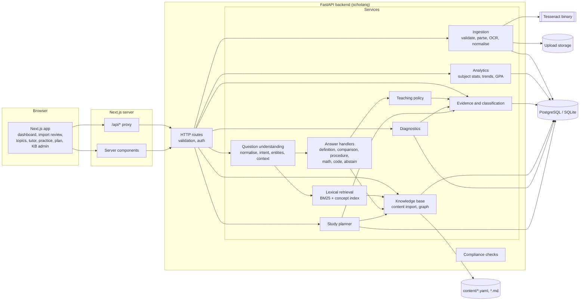
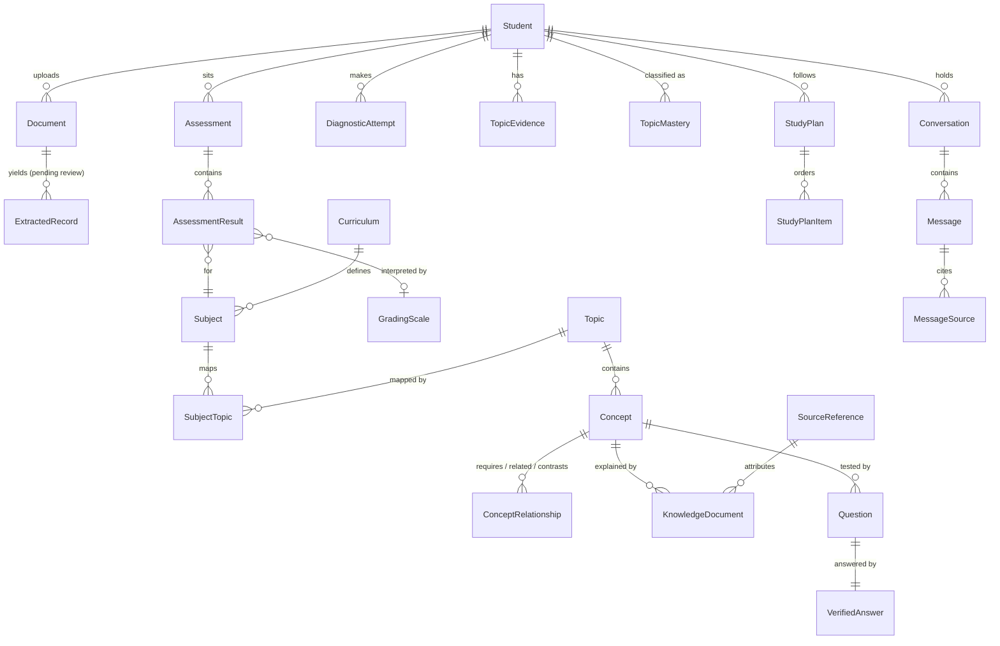

# ScholarIQ architecture

ScholarIQ analyses a student's marksheets, keeps an evidence-based model of
which topics they are strong or weak in, and answers academic questions from a
curated local knowledge base. Every piece of "intelligence" is a documented,
deterministic algorithm running on the ScholarIQ server. No language model,
hosted or local, is used anywhere.

This document is the architecture proposal. Sections marked *(planned)*
describe components that do not exist yet; see the roadmap for when each lands.

## 1. Starting point

There was no existing repository, so ScholarIQ starts as a new monorepo. Nothing
was overwritten or migrated.

## 2. Architecture in one paragraph

A Next.js frontend talks only to its own server, which proxies `/api/*` to a
FastAPI backend. The backend is a set of plain Python services with explicit
interfaces (ingestion, analytics, knowledge, retrieval, question understanding,
answer handlers, personalisation, planning). HTTP routes are thin adapters over
those services. PostgreSQL (or SQLite for a single-user offline install) holds
students' records, the knowledge base and the learner model. Knowledge content
is authored as versioned YAML/Markdown files in `content/`, validated, and
loaded into the database and an in-process BM25 index. Uploaded files sit on the
local filesystem with a retention policy.

## 3. Component diagram



### Knowledge base and retrieval *(implemented in Milestone 4)*

```
content/knowledge/*.yaml --load + validate--> KnowledgeContent --sync--> concepts, documents,
                                                                         questions, edges
concepts + documents --analyse--> BM25F-lite index (cached by content fingerprint)
query --analyse--> terms (+ joined compounds) --BM25--> scores --+ name/alias phrase bonus--> hits
```

* **Schema** (`knowledge/schema.py`): strict Pydantic models; unknown fields are
  errors. Multiple-choice questions need 2 to 6 distinct options and an answer
  index in range.
* **Loader** (`knowledge/loader.py`): collects every problem before failing:
  topic not in the curriculum or in the wrong subject folder, duplicate slugs,
  links or citations to unknown items, self-links and `requires` cycles.
* **Review**: a concept is `VERIFIED` only when its review block is `verified`
  and its 12-character content hash still matches; otherwise it is `IMPORTED`
  (not yet reviewed). Editing reviewed content therefore drops it back to
  unreviewed automatically. `knowledge/review.py` prints the block to paste.
* **Sync** (`knowledge/sync.py`): upserts by slug, retires removed items instead
  of deleting them (quiz history keeps its references), and rebuilds links.
* **Text analysis** (`retrieval/text.py`): accent folding, tokens that keep
  `c++`, `c#` and `3nf`, stopwords, `-ise` to `-ize`, Snowball stemming. Queries
  also drop words that describe the kind of answer wanted (explain, define,
  difference...).
* **Ranking** (`retrieval/bm25.py`, `knowledge/index.py`): BM25 (k1 1.2,
  b 0.75) over a weighted bag of fields (name x3, definition x2, document title
  x1.5, body x1), plus 4 points per word when a concept name or alias appears
  as a phrase in the query. Adjacent query words are also tried joined
  ("quick sort" -> quicksort) when the joined form is in the vocabulary. Each
  hit reports its per-word contributions and bonus; the Knowledge Base page
  shows them.
* **Trust filter**: `SCHOLARIQ_ALLOW_UNREVIEWED_CONTENT` (default true) decides
  whether unreviewed concepts are searchable. When they are, everything shown
  from them carries a "not yet reviewed by a person" label.
* **Evaluation**: `content/eval/retrieval.yaml` (84 queries: names, aliases,
  paraphrases, misspellings, out-of-scope) and `knowledge/evaluate.py`, which
  writes [eval/retrieval.md](eval/retrieval.md). A test keeps hit@1 >= 85% and
  hit@3 >= 90% on in-scope queries so ranking changes cannot regress silently.

Milestone 5 handles the two weaknesses above in the tutor rather than in
search: it corrects spelling before searching, and it declines questions whose
words the knowledge base mostly does not contain.

### Question answering *(implemented in Milestone 5, rules `tutor-rules/1`)*

```
question
  -> normalise (nlu/normalise.py): NFKC, keep notation (T(n), R = {(1, 2)}, SQL),
     split out fenced or indented code, expand shorthand from content/lexicon.yaml
     (diff b/w -> difference between; single letters are never expanded)
  -> spell-correct unknown words (nlu/spelling.py): Damerau-Levenshtein against
     the KB vocabulary; 1 edit from 5 letters, 2 from 8, and a 4-letter word only
     to a single whole concept name ("stak" -> stack). Ties go to whole names,
     then name frequency, then overall frequency, then alphabetical order
  -> intent grammar (nlu/intents.py): weighted regular-expression rules for the
     ten question types, follow-up phrases ("explain step 2 again", "simpler"),
     requested depth, references ("it", "that")
  -> link mentions (nlu/parser.py): longest span first; a concept's own name
     beats a topic name, which beats an alias, which beats a subject; a topic
     name that spans two concept names gives way to them
  -> resolve references against the conversation's stored context
  -> BM25 search (Milestone 4) over the corrected text; coverage = share of
     content words the KB contains
  -> decide (answering/engine.py):
       a written-out problem goes to a solver first
       ambiguous name: pick by subject context, else by score margin, else ask
       no named concept and (top score < 9.0 or coverage < 0.5): decline
       second score >= 0.9 x top without a clear name match: ask which was meant
  -> handler, with depth from the teaching policy
  -> validate: every section is backed by a KB entry, a solver or analysis, or
     is a fixed template; an unbacked section is an error, not an answer
  -> answer: sections with origins, sources, review status, limitations,
     interpretation trace, suggestions
```

Handlers: A definition and explanation; B comparison (a table of recorded
attributes only, "Not recorded in the knowledge base" otherwise); C procedure
(stored steps, never invented); D worked problems through `answering/solvers/`
(exact fractions, percentages, linear and quadratic equations, master theorem
and decrease-and-conquer recurrences, truth tables up to 6 variables, BFS, DFS
and shortest paths, SELECT on an in-memory practice database under an SQLite
authorizer and step limit); E code (Python `ast` templates for loops, halving
loops, sorting calls and recursion; the code is never executed; other languages
are recognised and declined); F decline, with the closest covered concepts.
Prerequisite, practice and study-advice handlers use the concept graph and the
student's topic evidence.

The teaching policy (`tutoring/policy.py`, `teaching-policy/1`) picks a brief
overview for Strong topics, step-by-step teaching for Needs attention, and the
standard depth otherwise; a depth the student asks for wins. It changes which
sections appear and their order, never their content. Asking the tutor about a
topic, and answering its check questions, is not evidence and never changes a
classification.

Quality is measured by `answering/evaluate.py` on `content/eval/answers.yaml`
(60 questions; status, handler, concepts, sections and exact solver results
must all match), reported in [eval/answers.md](eval/answers.md). Cases are
split into tuning and held-out; a held-out case that fails and is then fixed
moves to tuning. A test fails the build if any out-of-scope question is
answered or held-out accuracy drops below 90%.

## 4. Repository layout

```
backend/
  scholariq/
    api/routes/        HTTP adapters only
    core/              config, health, capabilities, logging
    compliance/        no-external-AI policy, scanner, runtime checks
    db/                SQLAlchemy models, engine/session
    domain/            enums and typed domain models
    ingestion/         validation, extraction, OCR, layout parsers, import service
    curriculum/        (M3) curriculum schema, YAML sync, subject matching
    analytics/         (M3) subject analytics, topic evidence and classification
    tutoring/          (M5) teaching policy, conversations and retention
    knowledge/         (M4) content schema, loader, sync, review, index, evaluation
    retrieval/         (M4) tokeniser, stemmer, BM25
    nlu/               (M5) normalising, spelling, intent grammar, mention linking
    answering/         (M5) answer engine, handlers, solvers, code analysis, gold evaluation
    diagnostics/       (M6) quiz selection, option shuffling, marking, evidence
    planning/          (M6) study-plan formula and service
  migrations/          Alembic
  tests/
frontend/
  app/                 Next.js App Router pages and the /api proxy
  components/  lib/  tests/
content/               curriculum, knowledge base, sources, shorthand lexicon, eval sets
docs/                  architecture, compliance, eval/ reports
docker-compose.yml
```

Packages under `compliance.policy.INTELLIGENCE_PACKAGES` are checked by the
architectural test to make sure they import no network libraries at all.

## 5. Data model

All ids are UUID strings so the schema is identical on PostgreSQL and SQLite.
Enumerations are stored as `VARCHAR` with `CHECK` constraints for the same
reason. The initial migration (`0001`) creates all 24 tables up front so later
milestones add behaviour rather than reshaping storage.



Design rules encoded in the schema:

| Rule | Where |
| --- | --- |
| A missing mark is `NULL` with status `missing`, never 0 | `assessment_results.marks_obtained`, `status` |
| Marks are within `[0, max]`; max > 0 | `CHECK` constraints on `assessment_results` |
| Extracted values are not academic records until reviewed | `extracted_records` vs `assessment_results.verified_by_student` |
| Unknown grade scales are not converted | `grading_scales.verified` |
| Theory and lab components are separate rows | `assessment_results.component` |
| Supplementary/backlog attempts are distinct, not overwritten | `assessments.exam_type`, `attempt_number` |
| One subject can map to many topics and vice versa | `subject_topics` with `importance` |
| Subject marks are a weak prior, stored as a distinct evidence kind | `topic_evidence.kind = subject_score_prior` |
| Every classification records its reasons and rule version | `topic_mastery.rationale`, `rule_version` |
| Only verified content may be cited | `trust_status` on concepts, documents, questions |
| Lesson completed is not mastery | `study_plan_items.status = lesson_completed` |
| Plan ranking is explainable | `study_plan_items.score_breakdown` |
| Deleting a student removes all their data | `ON DELETE CASCADE` from `students` |
| Duplicate uploads are detected | unique `(student_id, sha256)` on `documents` |

### Classification method *(implemented in Milestone 3, rules `topic-rules/1`)*

Evidence items carry a normalised score in [0, 1], a sample size and a kind.
Each kind has a configurable weight (subject prior lowest, topic exam and
diagnostics highest) and recency decay. The rule set, not a probability model,
produces one of four labels:

* **Insufficient evidence** when only the subject prior exists, or total
  topic-level sample size is below a threshold (default 5 questions).
* **Needs attention / Developing / Strong** from the weighted score against
  configurable thresholds, only when the sample-size rule is met.

The UI shows the label, the evidence list and the rule that fired. It never
shows a "mastery %" or presents thresholds as calibrated probabilities.

As built: a subject mark contributes at most one observation, self-assessments
are recorded with reduced weight but never count toward the five topic-level
observations, recency decays with a 180-day half-life, and when topic-level
evidence disagrees with the subject band the topic-level evidence wins and the
reason says so. Weights and thresholds live in `analytics/policy.py` and can be
overridden from the content directory; each classification records the rule
and policy versions.

### Diagnostic quizzes *(implemented in Milestone 6)*

`diagnostics/quiz.py` chooses up to `policy.quizzes.size` (5) questions for a
topic: least often shown to this student first, then longest ago, then a hash
of the quiz id and question slug; one application and one conceptual question
are guaranteed when the topic has them; shown easiest first. Options are
shuffled by sorting on a hash of (quiz id, slug, option index), and the order
is stored in `quiz_sessions.items`, so marking maps the displayed choice back
to the stored answer key. Submitting writes one `DiagnosticAttempt` per
question and one `TopicEvidence` row (kind diagnostic, score = fraction
correct, sample size = questions), then recomputes classifications with
`topic-rules/1`; the response carries the classification before and after.

### Study-plan priority *(implemented in Milestone 6, `plan-formula/1`)*

`priority = 3 need + 2 importance + 2 goal + 1 unlocks + 1 recent_result
- 0.5 study_time` (weights in `policy.plan`). need: Needs attention 1,
Developing 0.6, Insufficient evidence 0.5 (+0.2 when a subject mark that
includes the topic may need attention), Strong 0.1. importance: curriculum
1-5 / 5. goal: 1 if the student chose it. unlocks: planned topics that build on
it (max 3) / 3. recent_result: share missed in a quiz from the last 30 days.
study_time: minutes / 300, capped at 1. Strong topics are left out unless they
are goals. Topic prerequisites come from concept `requires` edges across
topics; a depth-first pass places a topic's planned prerequisites before it
(cycles are cut). Every term is stored in `score_breakdown` and shown.
Marking a topic as studied is stored on the plan item only and is never
evidence.

## 6. Dependencies

Each dependency was checked against the no-AI requirement. The full audit is in
[COMPLIANCE.md](COMPLIANCE.md).

| Package | Purpose | Milestone |
| --- | --- | --- |
| FastAPI, Uvicorn | HTTP API | 1 |
| Pydantic, pydantic-settings | request/response models, validated config | 1 |
| SQLAlchemy 2, Alembic | ORM and migrations | 1 |
| psycopg 3 | PostgreSQL driver | 1 |
| pytest, httpx, ruff, mypy | tests, lint, types | 1 |
| Next.js 16, React 19, TypeScript 5.9 (strict) | frontend | 1 |
| Tailwind CSS 4 | styling | 1 |
| Vitest, Testing Library, jsdom | frontend tests | 1 |
| python-multipart | file uploads | 2 |
| pypdf / pdfplumber (pdfminer.six) | digital PDF text and table extraction | 2 |
| pypdfium2 | rasterise scanned PDF pages for OCR | 2 |
| Pillow | image validation and preprocessing | 2 |
| pytesseract + Tesseract binary | local OCR | 2 |
| openpyxl | XLSX parsing | 2 |
| python-magic or signature checks | file type sniffing | 2 |
| Recharts | academic charts | 3 |
| PyYAML, markdown-it-py | knowledge-base content parsing | 4 |
| snowballstemmer | Porter2 stemming for retrieval | 4 |
| RapidFuzz | edit-distance spelling correction | 4/5 |
| SymPy | algebra, recurrences, simplification | 5 |
| sqlite3 (stdlib) | isolated in-memory SQL execution | 5 |
| Playwright | end-to-end tests | 7 |

Deliberately **not** used: spaCy, NLTK model downloads, Stanza, transformers,
sentence-transformers, any embedding model, EasyOCR/PaddleOCR/docTR (neural OCR
models), LangChain/LlamaIndex, and every hosted AI SDK.

Tesseract note: Tesseract 4+ recognises characters with an LSTM network that
ships as a local trained data file. It runs entirely offline, makes no network
calls, and is explicitly permitted by the requirements; it is the only learned
model in the system and is used only to turn pixels into characters.

## 7. Roadmap

| Milestone | Scope | Done when |
| --- | --- | --- |
| 1 Foundation | monorepo, FastAPI + Next.js skeleton, full schema + migration, config validation, health checks, Docker Compose, compliance scanner, CI | tests green on SQLite and PostgreSQL, compose stack boots and migrates |
| 2 Ingestion | upload validation, PDF/XLSX/CSV/text parsers, Tesseract OCR, pluggable layout parsers + generic fallback, confidence scores, review screen, grade-scale mapping, duplicate detection, delete-my-data | fixture marksheets of each format parse to the expected normalised rows; nothing is saved without confirmation |
| 3 Academic intelligence | subject analytics, credit weighting, trends, curriculum mapping, evidence model, classification engine, dashboard | hand-checked analytics fixtures; missing marks never become 0 |
| 4 Knowledge base and retrieval | seed CS curriculum (DS, Algorithms, OS, DBMS, CN, Discrete Maths), content validator/importer, concept graph, BM25 | retrieval eval: top-k hit rate on a curated question set, reported with failures |
| 5 Question answering | intent grammar, entity linking, context resolution, handlers A-F, teaching policy, citations, abstention | gold-standard answer tests incl. abstention and follow-ups |
| 6 Personalised learning | diagnostic quizzes, evidence updates, prerequisite-aware plans, progress | quiz results change classifications transparently |
| 7 Hardening | security review, offline tests, performance, accessibility, E2E, docs | definition-of-done walkthrough passes end to end |

## 8. Risks and trade-offs of AI-free question answering

1. **Coverage is bounded by content.** The tutor can only answer what the
   knowledge base covers. Mitigation: honest abstention with nearest known
   concepts, coverage reports, and an import pipeline that makes adding content
   cheap. The seed curriculum will be useful but not comprehensive, and the UI
   will say so.
2. **Language understanding is shallow.** A grammar plus lexicon handles the ten
   listed question types in common phrasings, not arbitrary language.
   Mitigation: clarifying questions when the top interpretations are close,
   spelling correction against the KB vocabulary, and an evaluation set that
   includes paraphrases. Question text is never logged, so grammar gaps have to
   be found through the evaluation set and feedback, not from usage logs.
3. **Answers are assembled, not composed.** Responses are built from verified
   sections, so they can read as structured rather than conversational, and
   cannot synthesise a novel explanation. This is the price of not
   hallucinating, and it is the right trade for a tutor.
4. **Subject marks say little about topics.** Topic labels will mostly be
   "insufficient evidence" until the student takes diagnostics. This is
   correct, but may feel underwhelming. Mitigation: make the first diagnostic
   short and prominent.
5. **OCR quality on scans.** Phone photos of marksheets vary widely. Mitigation:
   preprocessing (deskew, threshold), per-field confidence, and a mandatory
   review step. No value from OCR is trusted without confirmation.
6. **Marksheet layout diversity.** There is no universal format. Mitigation:
   pluggable layout parsers with a generic table/line fallback, and a review
   UI that makes correction fast.
7. **Solver scope.** Small hand-written solvers (no SymPy) handle defined
   problem families (arithmetic, percentages, linear and quadratic equations,
   recurrences of supported forms, truth tables, explicit graphs, SELECT on a
   sandbox DB). Anything else is declined, not attempted.
8. **Code questions.** Executing student code safely needs a real sandbox.
   Initially code is analysed statically (Python `ast`, pattern-based complexity
   templates) and execution is out of scope; this will be stated in answers.
9. **Content correctness is a human responsibility.** Verified status means a
   person reviewed it. Mitigation: provenance, versioning, review workflow, and
   tests that check every concept has a definition and source.
10. **Evaluation bias.** A gold set written by the same people who wrote the
    content will overstate quality. Mitigation: keep held-out paraphrases and
    report metrics with known limitations, never as "accuracy".

## 9. Security and privacy baseline

* The browser only talks to the Next.js origin; the API is proxied.
* Uploaded files are stored under random server-generated names (mode 0600)
  outside any served directory, with size limits and signature checks.
* All queries go through SQLAlchemy with bound parameters.
* Request bodies, files and question text are not logged. Tutor conversations
  are stored per student and deleted `SCHOLARIQ_CONVERSATION_RETENTION_DAYS`
  after their last message (default 30). Tutor questions are rate limited per
  student (60 a minute, in process).
* Startup fails if AI-provider credentials are present (`SCHOLARIQ_STRICT_AI_ENV_CHECK`).
* Deleting a student cascades to every student-owned row, and the same service
  deletes their uploaded files. Expired files are purged after uploads.
* Students are identified by an HMAC-signed HttpOnly cookie carrying the
  profile's session version. An optional email and scrypt-hashed password allow
  sign-in from another browser; changing the password or "sign out everywhere"
  bumps the version and invalidates older cookies. Sign-in is rate limited.
  Every document and record query is scoped to that student, and another
  student's ids return 404.
* The Next.js forwarder refuses cross-site state-changing requests; pages carry
  a Content Security Policy and the API sets nosniff, frame and no-store
  headers. The full review and residual risks are in [SECURITY.md](SECURITY.md).
* The Playwright suite (`frontend/e2e/`) runs the definition-of-done walkthrough,
  sign-in and axe accessibility checks against a throwaway stack whose API and
  web server refuse and record any non-loopback connection.
* Uploads are rate limited per student (20 per 10 minutes, in process).
