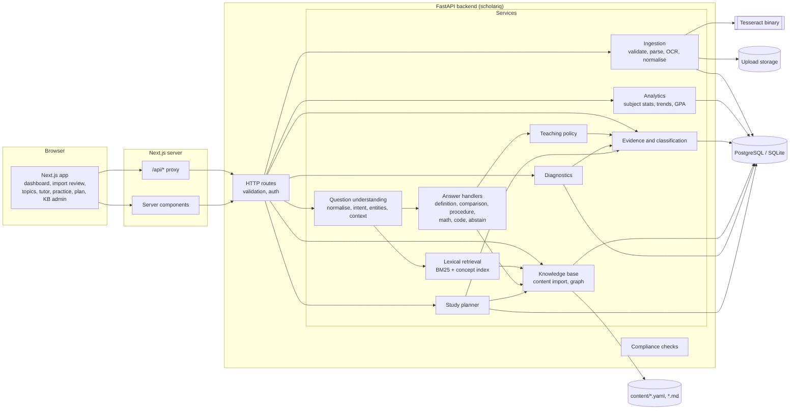
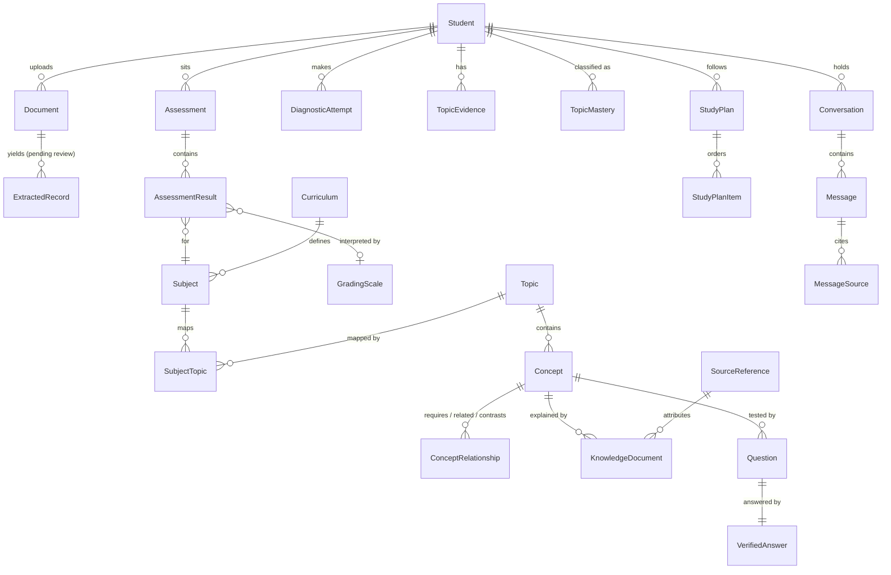

# ScholarIQ architecture

ScholarIQ analyses a student's marksheets, keeps an evidence-based model of
which topics they are strong or weak in, and answers academic questions from a
curated local knowledge base. Every piece of "intelligence" is a documented,
deterministic algorithm running on the ScholarIQ server. No language model,
hosted or local, is used anywhere.

This document is the architecture proposal. Sections marked *(planned)*
describe components that do not exist yet; see the roadmap for when each lands.

## 1. Starting point

There was no existing repository, so ScholarIQ starts as a new monorepo. Nothing
was overwritten or migrated.

## 2. Architecture in one paragraph

A Next.js frontend talks only to its own server, which proxies `/api/*` to a
FastAPI backend. The backend is a set of plain Python services with explicit
interfaces (ingestion, analytics, knowledge, retrieval, question understanding,
answer handlers, personalisation, planning). HTTP routes are thin adapters over
those services. PostgreSQL (or SQLite for a single-user offline install) holds
students' records, the knowledge base and the learner model. Knowledge content
is authored as versioned YAML/Markdown files in `content/`, validated, and
loaded into the database and an in-process BM25 index. Uploaded files sit on the
local filesystem with a retention policy.

## 3. Component diagram



### Question answering pipeline *(planned, Milestone 5)*

```
question
  -> normalise (keep math, code identifiers, SQL)
  -> tokenise, spell-correct against the KB vocabulary (edit distance)
  -> lexicon match: subjects, topics, concept aliases, abbreviations
  -> intent grammar: definition | explanation | comparison | procedure |
     worked problem | reasoning | prerequisites | practice | plan | follow-up
  -> context resolution against the conversation's structured history
  -> BM25 retrieval over verified knowledge documents
  -> re-rank: exact concept match, subject context, prerequisite edges, topic
  -> ambiguity check (score margin between top concepts) -> clarify?
  -> handler selection -> answer plan (sections, depth from teaching policy)
  -> validation: every section must be backed by a verified KB item or solver
  -> answer + citations + evidence status, or an explicit abstention
```

Answers are assembled from verified content, not generated. A handler that
cannot back a section with verified content leaves that section out and says so.

## 4. Repository layout

```
backend/
  scholariq/
    api/routes/        HTTP adapters only
    core/              config, health, capabilities, logging
    compliance/        no-external-AI policy, scanner, runtime checks
    db/                SQLAlchemy models, engine/session
    domain/            enums and typed domain models
    ingestion/         (M2) validators, parsers, OCR, normalisation
    analytics/         (M3) subject analytics
    tutoring/          (M3/M5) evidence, classification, teaching policy
    knowledge/         (M4) content loader, graph
    retrieval/         (M4) tokeniser, stemmer, BM25
    nlu/               (M5) query parsing
    answering/         (M5) handlers and solvers
    planning/          (M6) study plans
  migrations/          Alembic
  tests/
frontend/
  app/                 Next.js App Router pages and the /api proxy
  components/  lib/  tests/
content/               versioned knowledge base (M4)
docs/
docker-compose.yml
```

Packages under `compliance.policy.INTELLIGENCE_PACKAGES` are checked by the
architectural test to make sure they import no network libraries at all.

## 5. Data model

All ids are UUID strings so the schema is identical on PostgreSQL and SQLite.
Enumerations are stored as `VARCHAR` with `CHECK` constraints for the same
reason. The initial migration (`0001`) creates all 24 tables up front so later
milestones add behaviour rather than reshaping storage.



Design rules encoded in the schema:

| Rule | Where |
| --- | --- |
| A missing mark is `NULL` with status `missing`, never 0 | `assessment_results.marks_obtained`, `status` |
| Marks are within `[0, max]`; max > 0 | `CHECK` constraints on `assessment_results` |
| Extracted values are not academic records until reviewed | `extracted_records` vs `assessment_results.verified_by_student` |
| Unknown grade scales are not converted | `grading_scales.verified` |
| Theory and lab components are separate rows | `assessment_results.component` |
| Supplementary/backlog attempts are distinct, not overwritten | `assessments.exam_type`, `attempt_number` |
| One subject can map to many topics and vice versa | `subject_topics` with `importance` |
| Subject marks are a weak prior, stored as a distinct evidence kind | `topic_evidence.kind = subject_score_prior` |
| Every classification records its reasons and rule version | `topic_mastery.rationale`, `rule_version` |
| Only verified content may be cited | `trust_status` on concepts, documents, questions |
| Lesson completed is not mastery | `study_plan_items.status = lesson_completed` |
| Plan ranking is explainable | `study_plan_items.score_breakdown` |
| Deleting a student removes all their data | `ON DELETE CASCADE` from `students` |
| Duplicate uploads are detected | unique `(student_id, sha256)` on `documents` |

### Classification method *(planned, Milestone 3)*

Evidence items carry a normalised score in [0, 1], a sample size and a kind.
Each kind has a configurable weight (subject prior lowest, topic exam and
diagnostics highest) and recency decay. The rule set, not a probability model,
produces one of four labels:

* **Insufficient evidence** when only the subject prior exists, or total
  topic-level sample size is below a threshold (default 5 questions).
* **Needs attention / Developing / Strong** from the weighted score against
  configurable thresholds, only when the sample-size rule is met.

The UI shows the label, the evidence list and the rule that fired. It never
shows a "mastery %" or presents thresholds as calibrated probabilities.

### Study-plan priority *(planned, Milestone 6)*

`priority = w_need * need + w_imp * importance + w_goal * goal_match
+ w_unblock * unlocks - w_time * normalised_study_time`, with prerequisites
forced earlier by a topological pass over `requires` edges. Each term is stored
in `score_breakdown` and shown to the student.

## 6. Dependencies

Each dependency was checked against the no-AI requirement. The full audit is in
[COMPLIANCE.md](COMPLIANCE.md).

| Package | Purpose | Milestone |
| --- | --- | --- |
| FastAPI, Uvicorn | HTTP API | 1 |
| Pydantic, pydantic-settings | request/response models, validated config | 1 |
| SQLAlchemy 2, Alembic | ORM and migrations | 1 |
| psycopg 3 | PostgreSQL driver | 1 |
| pytest, httpx, ruff, mypy | tests, lint, types | 1 |
| Next.js 16, React 19, TypeScript 5.9 (strict) | frontend | 1 |
| Tailwind CSS 4 | styling | 1 |
| Vitest, Testing Library, jsdom | frontend tests | 1 |
| python-multipart | file uploads | 2 |
| pypdf / pdfplumber (pdfminer.six) | digital PDF text and table extraction | 2 |
| pypdfium2 | rasterise scanned PDF pages for OCR | 2 |
| Pillow | image validation and preprocessing | 2 |
| pytesseract + Tesseract binary | local OCR | 2 |
| openpyxl | XLSX parsing | 2 |
| python-magic or signature checks | file type sniffing | 2 |
| Recharts | academic charts | 3 |
| PyYAML, markdown-it-py | knowledge-base content parsing | 4 |
| snowballstemmer | Porter2 stemming for retrieval | 4 |
| RapidFuzz | edit-distance spelling correction | 4/5 |
| SymPy | algebra, recurrences, simplification | 5 |
| sqlite3 (stdlib) | isolated in-memory SQL execution | 5 |
| Playwright | end-to-end tests | 7 |

Deliberately **not** used: spaCy, NLTK model downloads, Stanza, transformers,
sentence-transformers, any embedding model, EasyOCR/PaddleOCR/docTR (neural OCR
models), LangChain/LlamaIndex, and every hosted AI SDK.

Tesseract note: Tesseract 4+ recognises characters with an LSTM network that
ships as a local trained data file. It runs entirely offline, makes no network
calls, and is explicitly permitted by the requirements; it is the only learned
model in the system and is used only to turn pixels into characters.

## 7. Roadmap

| Milestone | Scope | Done when |
| --- | --- | --- |
| 1 Foundation | monorepo, FastAPI + Next.js skeleton, full schema + migration, config validation, health checks, Docker Compose, compliance scanner, CI | tests green on SQLite and PostgreSQL, compose stack boots and migrates |
| 2 Ingestion | upload validation, PDF/XLSX/CSV/text parsers, Tesseract OCR, pluggable layout parsers + generic fallback, confidence scores, review screen, grade-scale mapping, duplicate detection, delete-my-data | fixture marksheets of each format parse to the expected normalised rows; nothing is saved without confirmation |
| 3 Academic intelligence | subject analytics, credit weighting, trends, curriculum mapping, evidence model, classification engine, dashboard | hand-checked analytics fixtures; missing marks never become 0 |
| 4 Knowledge base and retrieval | seed CS curriculum (DS, Algorithms, OS, DBMS, CN, Discrete Maths), content validator/importer, concept graph, BM25 | retrieval eval: top-k hit rate on a curated question set, reported with failures |
| 5 Question answering | intent grammar, entity linking, context resolution, handlers A-F, teaching policy, citations, abstention | gold-standard answer tests incl. abstention and follow-ups |
| 6 Personalised learning | diagnostic quizzes, evidence updates, prerequisite-aware plans, progress | quiz results change classifications transparently |
| 7 Hardening | security review, offline tests, performance, accessibility, E2E, docs | definition-of-done walkthrough passes end to end |

## 8. Risks and trade-offs of AI-free question answering

1. **Coverage is bounded by content.** The tutor can only answer what the
   knowledge base covers. Mitigation: honest abstention with nearest known
   concepts, coverage reports, and an import pipeline that makes adding content
   cheap. The seed curriculum will be useful but not comprehensive, and the UI
   will say so.
2. **Language understanding is shallow.** A grammar plus lexicon handles the ten
   listed question types in common phrasings, not arbitrary language.
   Mitigation: clarifying questions when the top interpretations are close,
   spelling correction against the KB vocabulary, an evaluation set that
   includes paraphrases, and logging (without student identity) of unparsed
   question shapes to guide grammar work.
3. **Answers are assembled, not composed.** Responses are built from verified
   sections, so they can read as structured rather than conversational, and
   cannot synthesise a novel explanation. This is the price of not
   hallucinating, and it is the right trade for a tutor.
4. **Subject marks say little about topics.** Topic labels will mostly be
   "insufficient evidence" until the student takes diagnostics. This is
   correct, but may feel underwhelming. Mitigation: make the first diagnostic
   short and prominent.
5. **OCR quality on scans.** Phone photos of marksheets vary widely. Mitigation:
   preprocessing (deskew, threshold), per-field confidence, and a mandatory
   review step. No value from OCR is trusted without confirmation.
6. **Marksheet layout diversity.** There is no universal format. Mitigation:
   pluggable layout parsers with a generic table/line fallback, and a review
   UI that makes correction fast.
7. **Solver scope.** SymPy and custom solvers handle defined problem families
   (recurrences of supported forms, truth tables, explicit graphs, SQL on a
   sandbox DB). Anything else is declined, not attempted.
8. **Code questions.** Executing student code safely needs a real sandbox.
   Initially code is analysed statically (Python `ast`, pattern-based complexity
   templates) and execution is out of scope; this will be stated in answers.
9. **Content correctness is a human responsibility.** Verified status means a
   person reviewed it. Mitigation: provenance, versioning, review workflow, and
   tests that check every concept has a definition and source.
10. **Evaluation bias.** A gold set written by the same people who wrote the
    content will overstate quality. Mitigation: keep held-out paraphrases and
    report metrics with known limitations, never as "accuracy".

## 9. Security and privacy baseline

* The browser only talks to the Next.js origin; the API is proxied.
* Uploaded files are stored under server-generated names outside any served
  directory, with size limits and signature checks (M2).
* All queries go through SQLAlchemy with bound parameters.
* Request bodies, files and question text are not logged.
* Startup fails if AI-provider credentials are present (`SCHOLARIQ_STRICT_AI_ENV_CHECK`).
* Deleting a student cascades to every student-owned row; uploaded files are
  removed by the same service (M2).
* Authentication arrives with multi-user features in M2; until then the app is
  single-user and must not be exposed publicly.
